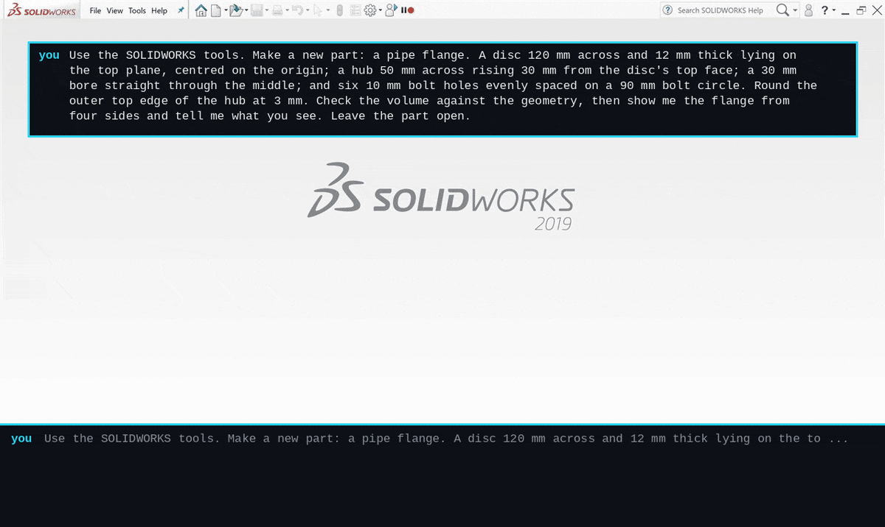
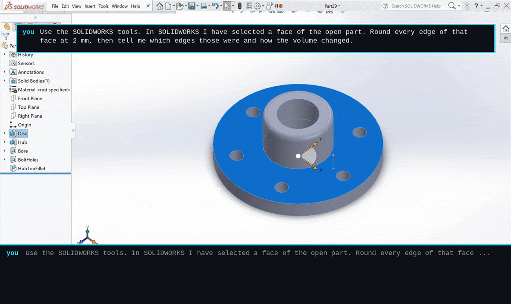
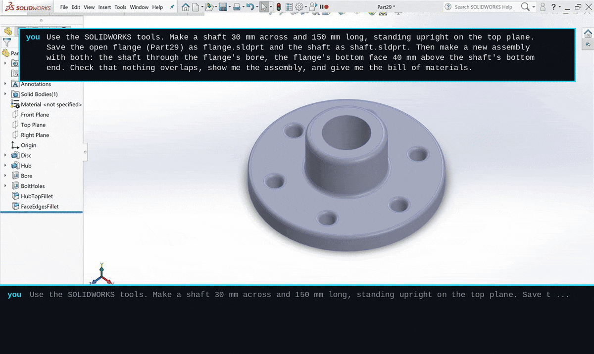
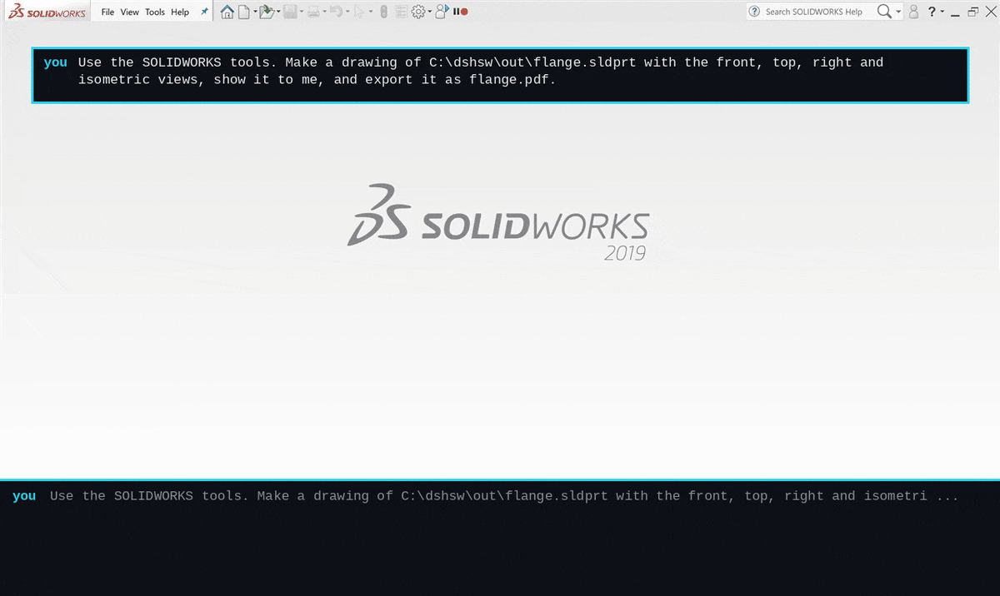
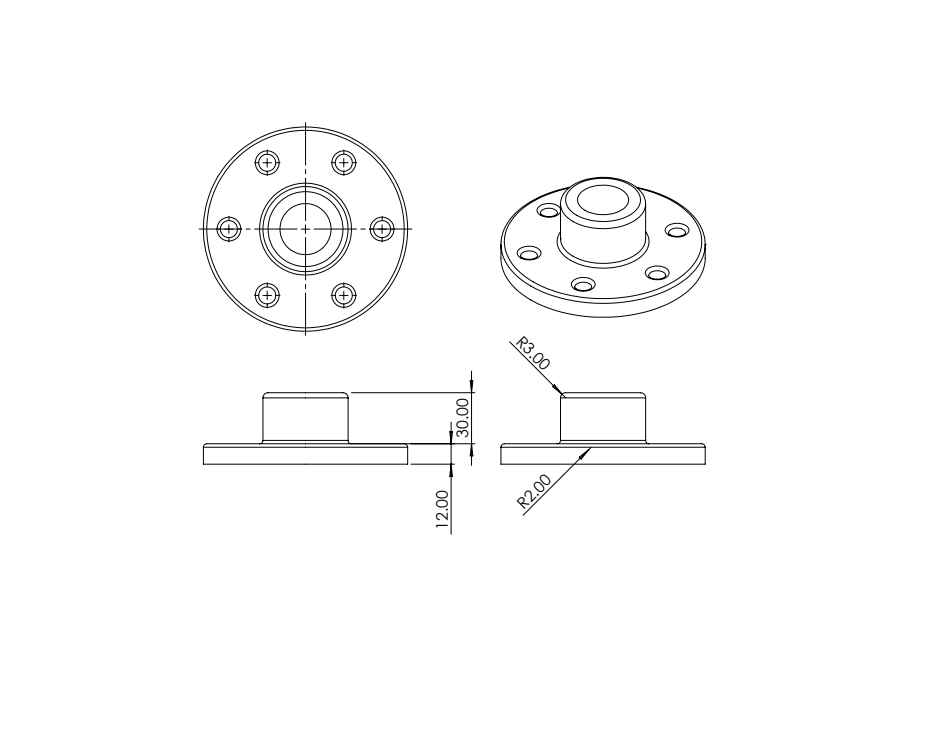
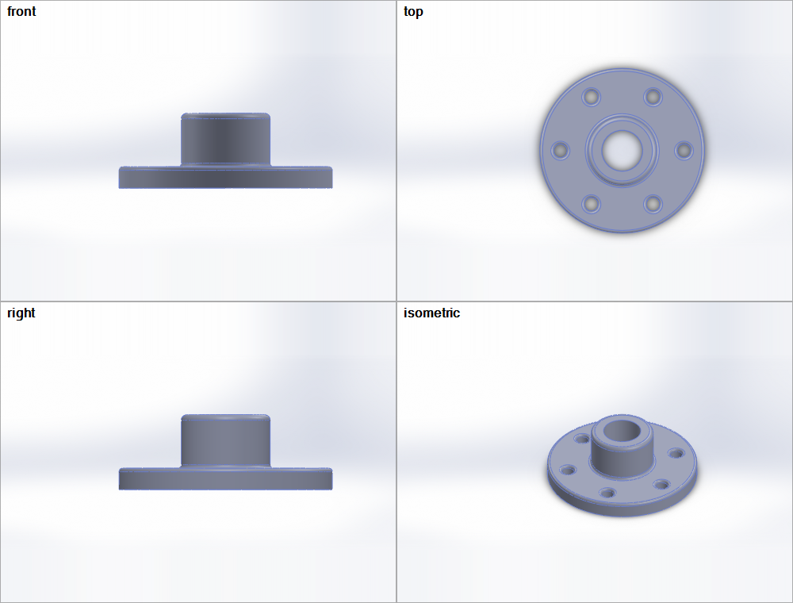

<div align="center">

```
   ___ _      __     dsh-solidworks
  / __| \    / /
  \__ \\ \/\/ /      SOLIDWORKS for DeepSeek Harness:
  |___/ \_/\_/       model, assemble, check, draw and export, in the SOLIDWORKS on your desk
```

**dsh drives the SOLIDWORKS you already have open: 2016 and later, on the same PC or in a Windows VM on your Mac.**

</div>

<p align="center"><strong>
21 tools · verified on SOLIDWORKS 2016 SP1 and 2019 SP0 · one bridge exe, no runtime to install, no admin · your files read-only by default · MIT
</strong></p>

<p align="center">
<a href="https://github.com/dshworks/dsh-solidworks/actions/workflows/ci.yml"></a>
<a href="https://www.npmjs.com/package/@dshworks/dsh-solidworks"></a>
<a href="LICENSE"></a>


</p>

<p align="center">
<a href="#watch-it">Watch it</a> ·
<a href="#get-started">Get started</a> ·
<a href="#tools">Tools</a> ·
<a href="#what-it-will-not-do">What it will not do</a> ·
<a href="#how-it-works">How it works</a> ·
<a href="#proof">Proof</a> ·
<a href="#when-to-skip-it">When to skip it</a> ·
<a href="llms.txt">llms.txt</a> ·
<a href="README.zh.md">中文</a>
</p>

---

<p align="center">

</p>

**One paragraph in, a flange out.** You describe the part; dsh models it in the
SOLIDWORKS on your desk, checks the volume against its own arithmetic
(158,983.493 mm³ both ways), and looks at it from four sides. It can also put
parts together, check them for collisions, count a bill of materials, make the
drawing, and work on the files you already have, read-only unless you say
otherwise.

## Watch it

Every clip is a real session: dsh 0.2.0-rc.2 with `deepseek-flash`, SOLIDWORKS
2019 SP0 in a Parallels VM, recorded from the SOLIDWORKS window. The captions
are the session's own tool calls and results, and its own closing words. Time
spent thinking is fast-forwarded; nothing is cut or reordered.
[How the clips are made](scripts/clips/README.md).

### Point at it

You select a face in SOLIDWORKS and say what to do with it. dsh reads your
selection (the flange's top face, 8 edges), rounds every edge of it at 2 mm, and
explains why the volume went down by 360.218 mm³ even though one fillet adds
material.

<p align="center"></p>

### Put parts together, check they fit

A shaft is modeled, both parts saved, and assembled with the shaft through the
bore and the flange 40 mm up. Interference: 0 pairs. dsh also counts faces that
only touch, and points out that a 30 mm shaft in a 30 mm bore is a line-to-line
fit. Then the bill of materials.

<p align="center"></p>

### Draw it

The drawing lays its views out in projection at the largest standard scale that
fits, brings in the model's dimensions, and comes back to your workspace as a
PDF.

<p align="center"></p>

<p align="center">


</p>
<p align="center"><sub>Left: the PDF as exported. Right: <code>sw_view</code>, four views on one picture, which is how dsh looks at what it made.</sub></p>

## Get started

You need dsh 0.2.0-rc.2 or later (its `dsh plugin add` uses pnpm, so pnpm on
the PATH) and a running SOLIDWORKS 2016 or later.

### dsh and SOLIDWORKS on the same Windows PC

```
dsh plugin --profile web add @dshworks/dsh-solidworks
```

Start SOLIDWORKS, start dsh, ask. The plugin runs its bundled `swbridge.exe`
on the first SOLIDWORKS question; there is nothing to pair or install.

### dsh on a Mac, SOLIDWORKS in a Windows VM

1. On the Mac: `dsh plugin --profile web add @dshworks/dsh-solidworks`, then
   start dsh once. It listens for the bridge and writes a pairing kit.
2. In the VM, signed in as the person who uses SOLIDWORKS, open
   `\\Mac\Home\.dsh\dsh-solidworks\windows\` (Parallels shares your Mac home
   folder there) and double-click `pair.cmd`.

That installs the bridge for that Windows user, connects it to dsh, and starts
it at every sign-in. No administrator, no firewall rule: the bridge dials out
to dsh, so Windows never opens a port. If you ask dsh before pairing, the
answer says where the kit is.

On VMware, another PC, or a Mac without Parallels sharing, copy the
`~/.dsh/dsh-solidworks/windows/` folder to the Windows machine and run
`pair.cmd` there. If the VM reaches your Mac on an address the kit did not
list, set it:

```yaml
# ~/.dsh/profiles/web/cordis.patch.yml
- id: dsh-solidworks
  config:
    advertise: ['10.211.55.2']   # Parallels' usual host address
```

Undo it in the VM with `%LOCALAPPDATA%\dsh-solidworks\swbridge.exe uninstall`.

### Any other MCP client, on the Windows PC

`swbridge.exe mcp` is a plain stdio MCP server with the same 21 tools:

```
claude mcp add solidworks -- C:\tools\swbridge.exe mcp
```

The exe is in this package at `bin/swbridge.exe` and on every
[GitHub release](https://github.com/dshworks/dsh-solidworks/releases) with its
SHA-256.

## Tools

Lengths are millimetres, angles degrees, mass kilograms, whatever units the
document uses; field names say so (`value_mm`, `mass_kg`). Geometry is
addressed in one space everywhere: model-space points `[x, y, z]` in mm, Y up,
the front plane at z = 0, top at y = 0, right at x = 0. Faces and edges are
picked by a point on them. `doc` is a path, file name or title of an open
document and defaults to the active one.

<details>
<summary><b>All 21 tools</b></summary>

| Tool | What it does |
| --- | --- |
| `sw_status` | Release (2016 SP1, 2019 SP0, ...), every SOLIDWORKS instance, the open documents, and any dialog SOLIDWORKS is waiting on. Called first. |
| `sw_open` | Open a `.sldprt`, `.sldasm` or `.slddrw`, read-only unless asked, and activate it. |
| `sw_new` | A new, empty part or assembly from SOLIDWORKS' default template. |
| `sw_inspect` | Type, units, configurations, material, custom properties, bounding box, body and component counts. |
| `sw_features` | The feature tree with suppression state and rebuild errors. |
| `sw_parameters` | Every dimension (`D1@Sketch1`, value, unit, driven or not) and equation, global variables marked. |
| `sw_components` | An assembly's component tree: file, configuration, state, fixed, position. |
| `sw_mass_properties` | Mass, volume, surface area, density, centre of mass. |
| `sw_probe` | What is at a point: the face, edge or vertex there, with its surface or curve, area or length, normal or axis, diameter and the feature that made it. Without points, whatever the user has selected in SOLIDWORKS right now. Two entities also give the distance and angle between them. |
| `sw_edit` | In memory, then one rebuild: configuration, suppress/unsuppress, global variables, dimensions, custom properties. Each change comes back with before, after and its own outcome. |
| `sw_build` | Model a part in steps: sketch (lines, polylines, rectangles, circles, arcs, centerlines) on a plane or a face, extrude or cut (blind, through all, mid-plane, draft), revolve, fillet, chamfer, shell, offset plane, delete. A failing step undoes the call. Returns each feature with its dimensions, and the part's volume and box. |
| `sw_study` | Up to 50 variants of dimensions and variables in one call, each rebuilt and measured (mass, volume, area, centre of mass, size); every value put back and checked afterwards. |
| `sw_rebuild` | Rebuild and list every feature that fails, with the reason. |
| `sw_assemble` | Insert saved parts with their origin at a point, mate planes, faces, edges or vertices (coincident, concentric, parallel, perpendicular, tangent, distance, angle), fix and float. |
| `sw_interference` | Every pair of components that overlap, with the shared volume, largest first. |
| `sw_bom` | Bill of materials: each file and configuration with its quantity and custom properties, flattened to parts or top-level; optionally a CSV. |
| `sw_drawing` | A drawing of a saved model: views in first- or third-angle projection, the largest standard scale that fits the sheet, the model's dimensions brought in. |
| `sw_export` | A copy in STEP, IGES, Parasolid, ACIS, STL, PDF, DXF/DWG, eDrawings, JPG/PNG/TIF, or native. Path, size and SHA-256 back; fetched into the dsh workspace when the bridge is on another machine. |
| `sw_save` | Save as a new file in an allowed folder (how new documents get one), or over the source file if the bridge was started with `--allow-save`. |
| `sw_close` | Close a document; unsaved changes are discarded only if this bridge made them. |
| `sw_view` | A PNG of the model: one standard view or up to six on one labelled picture, shaded, wireframe or hidden-line. The user's view is put back afterwards. |

</details>

## What it will not do

The rules are enforced on the Windows side, where the files are. dsh can ask
for anything; only the bridge decides.

- **Change your file without being told to.** Documents open read-only by
  default; `sw_edit`, `sw_build`, `sw_study` and `sw_assemble` work in memory;
  `sw_save` writes a new file into an allowed folder, and over a source file
  only if the bridge was started with `--allow-save`.
- **Delete your work.** `sw_build` deletes only features it built in this
  bridge session, and a sketch of yours that one of them consumed stays; your
  features can be suppressed, not removed. It refuses to build while the
  rollback bar is above the end of the tree, where new features would land
  among yours. `sw_study` puts every value back and checks that it did.
- **Write outside its folders.** Exports, saved copies and BOM files go to
  `Documents\dsh-solidworks`, or a folder you allowed with `--allow-write`. An
  existing file is replaced only when asked.
- **Throw away someone's work.** It closes a document with unsaved changes only
  if this bridge opened or made that document and the call says `discard`.
- **Start, close or click SOLIDWORKS.** It attaches to the SOLIDWORKS in front
  of you, never starts or quits one, and never answers a dialog: it tells you
  the dialog's text instead, because answering is your decision.
- **Run code.** No macro, script or "invoke any API" tool. Every SOLIDWORKS
  call it can make is in [`bridge/compat/members.tsv`](bridge/compat/members.tsv).
- **Put the pairing token in the model's context.** The "not connected" answer
  says where the kit is, never the token, so transcripts do not carry it.

The link between dsh and a bridge on another machine is authenticated both
ways (each side proves the token with HMAC-SHA256 over fresh nonces before a
single call crosses) but not encrypted. It is meant for a host-only VM network
or a local one; across anything else, carry it through SSH or a VPN. See
[SECURITY.md](SECURITY.md).

## How it works

```
 dsh (Windows, macOS, Linux)                        Windows, the user's desktop session
 +-------------------------------+                  +----------------------------------+
 | @dshworks/dsh-solidworks      |   same PC:       | swbridge.exe  (.NET Framework 4.8)|
 |  21 sw_* tools, built with    |   stdio MCP      |  MCP server, protocol/tools.json  |
 |  dsh's own MCP tool factory   | <--------------> |  one STA thread + OLE msg filter  |
 |  spawn | listen                |   VM / other PC: |  IDispatch late binding           |
 +-------------------------------+   the bridge     |        |                          |
              ^                      dials dsh       |        v  COM, out of process     |
              |  protocol/tools.json  (HMAC pairing) |  SOLIDWORKS 2016 ... current      |
              +----- one contract, both halves ----- +----------------------------------+
```

<details>
<summary><b>The design, point by point</b></summary>

- **One space for geometry.** Sketch points, picks, probes, component origins
  and bounding boxes are all model-space millimetres. The bridge maps each
  sketch point through the sketch's own transform, so a circle on a face goes
  where the model said, whatever axes SOLIDWORKS gave that face's sketch. A pick
  asks every face or edge for its closest point to the target, so it does not
  depend on the view, the zoom or what is in front, and it never touches your
  selection.
- **Checks against intent.** `sw_build` answers with the part's volume and box,
  `sw_probe` with areas and distances, `sw_interference` with overlap volumes:
  numbers the model compares with what it meant to make. A build that fails
  halfway removes what it made, so the part is either built or as it was.
- **One exe for every release.** The bridge references no SOLIDWORKS interop
  assembly. Every call goes through `IDispatch` by name, so the build that
  drives 2016 drives 2019 and later, and builds on Linux CI. `dynamic` and
  PowerShell's COM adapter both fail on SOLIDWORKS objects out of process
  (`TYPE_E_ELEMENTNOTFOUND`, measured); `Type.InvokeMember` does not.
- **2016 is checked, not assumed.** `bridge/compat/members.tsv` lists the
  200 members the bridge calls, each with its interface. A test fails if the
  bridge calls anything not listed, names a member any way but as a literal, or
  if a listed member is missing from the SOLIDWORKS 2016 SP1 interop. It is how
  `SaveAs2` (2019 SP1+), `Get6` (2018+) and `IEquationMgr.GlobalVariable`
  (2016 SP4+) stay out.
- **The instance you are looking at.** Every SOLIDWORKS registers
  `SolidWorks_PID_<pid>` in the desktop's Running Object Table. The bridge
  picks the visible one highest in the window Z-order instead of whatever
  `GetActiveObject` returns. We found machines with four instances, three of
  them invisible and stuck on a startup dialog.
- **Busy, not hung.** All calls run on one STA thread with an OLE message
  filter that retries while SOLIDWORKS is busy. A call that outlives its budget
  returns `TIMEOUT` and says whether it may still complete; later calls fail
  fast with `SW_BUSY` instead of queueing behind it, and `sw_status` still
  answers and names the dialog SOLIDWORKS is waiting on.
- **Dial out, not listen.** On another machine the bridge connects to dsh.
  Windows Firewall blocks inbound by default and opening a port takes an
  administrator; an outbound connection takes neither and works from behind
  the VM's NAT. The first bridge keeps the link; a heartbeat frees it within
  seconds when that bridge goes away.
- **One contract.** `protocol/tools.json` holds the names, schemas, budgets and
  error codes. The bridge embeds it; the plugin builds dsh tools from it with
  dsh's own `createMcpToolDefinition`, so validation, error results and image
  admission behave as for any MCP server.

</details>

## Proof

Every claim on this page was run, against real SOLIDWORKS, on 2026-10-18.

| What | Result |
| --- | --- |
| Live end-to-end, SOLIDWORKS 2016 SP1 (24.1.0) | 66 of 66 checks, through the real dial-out link, with the release exe |
| Live end-to-end, SOLIDWORKS 2019 SP0 (27.0.0) | 66 of 66 checks, same exe |
| Real dsh 0.2.0-rc.2 + `deepseek-flash`, dsh on Linux, SOLIDWORKS 2019 in a VM (listen) | the four clips above: 12, 17, 23 and 13 tool calls; one refused (a BOM asked of a part: `WRONG_DOC_TYPE`, which the model corrected), the rest completed |
| Real dsh 0.2.0-rc.2 + `deepseek-flash`, dsh on the Windows PC itself (spawn) | run on 0.1.0, unchanged since: the plugin started its bundled bridge through dsh's subprocess service; 5 tool calls, 5 completed; no bridge left running after dsh exited |
| The published `swbridge.exe` | rebuilt from source by CI to the same SHA-256 (`bridge/swbridge.exe.sha256`) |
| Pairing from the generated `pair.cmd`, sign-in start, `uninstall` | run on 0.1.0, unchanged since: installed with no admin, one instance under the mutex, nothing left after uninstall |
| Unit tests (Linux, no SOLIDWORKS) | 48, including the 2016 member check and both-sides contract checks |
| `swbridge selftest` (Windows, no SOLIDWORKS) | paths, units, JSON, drawing layout and scale, picture letterboxing, CSV, HMAC vector shared with the plugin |

<details>
<summary><b>What the live checks compare against, and how long things take</b></summary>

The end-to-end checks test each answer against something the tool did not say
about itself. The modelling ones compute it from the geometry asked for: the
plate above must come to 6000·20 − π·10²·20 − 4·25·(1 − π/4)·20 mm³ and its top
face to that area over 20; a 50 mm cube shelled at 2 mm with one face open to
50³ − 46²·48 = 23,432 mm³; a revolved 10/20 mm tube 30 mm long with a 1 mm
chamfer to π(20² − 10²)·30 − π·(20 − 1/3); a design study at 10 and 40 mm to
that area times 10 and 40, and the plate back at 20 afterwards; two plates mated
face to face must not interfere and a third pushed 10 mm into both must overlap
each by exactly the top face area times 10; the BOM must count 3; the drawing
must have its four views at the sheet's scale and export as `%PDF-`. The
ownership checks build on a sketch the bridge did not make (saved, closed and
reopened, so it is forgotten): a failed build and a delete of what was built on
it must leave that sketch in place, and a sketch that fails on its second
entity must leave the feature tree exactly as it was. A blind cut sketched on
a plane under the body must reverse itself and remove exactly π·5²·4 mm³, and a
drawing saved next to its part must be the document its `.slddrw` name exports.
The
reading ones from 0.1.0 still run: the stock `box.sldprt` must reach 325,500
mm³ after `sw_edit` sets its depth to 150 mm, the fetched STEP must hash to the
bridge's SHA-256, the refusals must return their codes. On 2016 the run used a
SOLIDWORKS that someone else had a 58-document assembly open in; a check
confirms their documents, dirty flags, active document and the 57 parts their
assembly had loaded came back unchanged.

Measured through the link in the 0.2.1 runs, SOLIDWORKS under x64 emulation on
Windows 11 ARM64 (the slower end is the 2016 SOLIDWORKS that also holds the
58-document assembly): the five-step plate build 3.2-4.3 s, a probe 0.3-0.9 s, a
four-view picture 2.5-3.4 s, a drawing 1.9-3.9 s, interference on a three-part
assembly 1.1-3.2 s, open a part 1.3-1.5 s, export STEP 0.4-0.5 s.

</details>

Not verified yet: SOLIDWORKS 2020 and later, Windows 10, x64 hardware. Reports
welcome: [open an issue](https://github.com/dshworks/dsh-solidworks/issues/new/choose)
with `swbridge status` pasted in.

## When to skip it

- **You need lofts, sweeps, patterns, the Hole Wizard or sheet metal.**
  `sw_build` covers sketch, extrude, cut, revolve, fillet, chamfer, shell and
  planes. Sketches are exact but carry no sketch dimensions or relations; the
  features' own dimensions (depths, radii, angles) are named and drivable.
- **Your files are STEP or IGES.** `sw_open` opens SOLIDWORKS documents; import
  them in SOLIDWORKS first.
- **You need it in the SOLIDWORKS window.** There is no task pane; the
  conversation is in dsh.
- **You want to walk 50,000 faces.** Out-of-process COM costs a round trip per
  call, and a probe asks every face near the point. The tools return summaries;
  geometry-heavy work belongs in an add-in or on an exported STEP.
- **You run several SOLIDWORKS machines into one dsh at once.** One bridge holds
  the link at a time.

## Troubleshooting

<details>
<summary><b>Error messages and what they mean</b></summary>

| You see | It means |
| --- | --- |
| `NOT_CONNECTED` | No bridge has paired with this dsh. Run `pair.cmd` in the VM; if it ran, check `%LOCALAPPDATA%\dsh-solidworks\bridge.log` there. |
| `SW_NOT_RUNNING` | No SOLIDWORKS in that Windows session, or it is still starting. A second SOLIDWORKS session on one machine stops at "A journal file could not be created" until someone clicks OK. |
| `SW_BUSY` / `TIMEOUT` with a dialog's text | SOLIDWORKS is waiting for a person. Answer the dialog on the Windows desktop. |
| `OPEN_FAILED: saved by a newer SOLIDWORKS` | Files open only in the release that saved them or later. |
| `DIRTY ... was not opened by this bridge process` on a document dsh made | The bridge restarted and no longer knows it made that document. Close it in SOLIDWORKS. |
| `no face within 0.5 mm of [x, y, z]` | The point is not on the model where the call assumed; the message names the nearest face or edge and how far it is. Components move when mated: use where they are now. |
| `another bridge holds the link` (in the bridge log) | A second machine is paired with the same dsh; the first one connected keeps it. |
| `the bridge on ... does not have sw_...` | The Windows PC still runs the bridge it was paired with before the plugin was updated. Run `pair.cmd` there again. |

</details>

## Configuration

<details>
<summary><b>Plugin and bridge options</b></summary>

The plugin row, `id: dsh-solidworks`:

| Key | Default | |
| --- | --- | --- |
| `link` | `auto` | `spawn` (dsh on the SOLIDWORKS PC), `listen` (bridge elsewhere); `auto` picks spawn on Windows |
| `listen.host` / `listen.port` | `0.0.0.0` / `47321` | where dsh listens for a bridge; it answers only one that proves the token |
| `advertise` | `[]` | addresses written into `pair.cmd`; empty lists this machine's, VM networks first |
| `token` | `''` | empty keeps a generated one in `$DSH_HOME/dsh-solidworks/pairing.json` |
| `bridge.out`, `bridge.allowWrite`, `bridge.allowSave`, `bridge.pid` | | spawn mode: passed to the bridge as its flags |
| `fetchDir` | `solidworks` | where exports and BOM files from a remote bridge land in the workspace; empty keeps them on Windows |
| `startupWaitMs` | `15000` | how long a call right after dsh starts waits for the bridge to reconnect |

The bridge, `swbridge.exe`: `mcp`, `connect`, `status`, `uninstall`, with
`--out`, `--allow-write`, `--allow-save`, `--pid`. `swbridge help` has the rest.

</details>

## Prior art

- [wzyn20051216/solidworks-automation-skill](https://github.com/wzyn20051216/solidworks-automation-skill)
  (MIT): the broadest open SOLIDWORKS MCP server, a 61-tool Python server with a
  careful authenticated HTTP transport. Python plus pywin32 on the CAD machine,
  every tool in every turn.
- [eyfel/mcp-server-solidworks](https://github.com/eyfel/mcp-server-solidworks)
  (SolidPilot, AGPL-3.0) and
  [tian-yu200/dsh-solidworks](https://github.com/tian-yu200/dsh-solidworks)
  (AGPL-3.0): the best modelling ideas, targeting SOLIDWORKS 2026 with an
  interop built per release.
- [Slacker-LLC/solidworks-mcp](https://github.com/Slacker-LLC/solidworks-mcp)
  (Apache-2.0): clean code; uses members that 2016 lacks.

What this one does differently: one model-space coordinate system for every
tool, builds that undo themselves when a step fails, a 2016 floor that a test
enforces, one exe with no runtime to install, a link that needs no open port,
and dsh's own tool plumbing instead of a parallel one. No code was copied from
any of them.

## Development

```
npm install && npm test              # plugin + contract + 2016 member check, no Windows needed
npm run build:bridge                 # .NET 8 SDK; builds bin/swbridge.exe for net48
SW_LINK_TOKEN=... node tests/live/e2e.mjs   # live run against a bridge that dials this machine
```

[CONTRIBUTING.md](CONTRIBUTING.md) has the rest, including how to run the live
checks against your own SOLIDWORKS. `bridge/compat/README.md` explains how
`sw2016.tsv` is regenerated from an installed interop. `node scripts/format-contract.mjs` keeps
`protocol/tools.json` in its layout. MIT, see [LICENSE](LICENSE).
